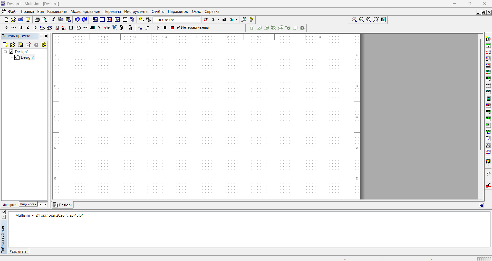

# Русификатор Multisim / Circuit Design Suite 14.3

Русский языковой комплект для **NI Multisim / Circuit Design Suite 14.3 на Windows**. Пакет дополнен переводом диспетчера баз данных, окна выбора компонентов и подсказок панели компонентов. Имя файла в релизе записано латиницей.

Это неофициальная локализация. Оригинальная программа и её ресурсы принадлежат правообладателям. Установщик Multisim в комплект не входит: сначала должна быть установлена совместимая версия 14.3.

## Скачать

**[Multisim_14.3_Russian.zip](https://github.com/arandit21/Multisim-14.3-Russian/releases/download/multisim-14.3-russian-v2/Multisim_14.3_Russian.zip)** · [Все файлы релиза](https://github.com/arandit21/Multisim-14.3-Russian/releases/tag/multisim-14.3-russian-v2)

SHA-256 архива:

```text
2194b259da4eedd97458b46944bc05e96933a15a02b1c1aa70f95104bd45d054
```

Проверка скачанного файла в PowerShell:

```powershell
Get-FileHash .\Multisim_14.3_Russian.zip -Algorithm SHA256
```

## Что входит

- **146 языковых файлов** в `stringfiles\Russian`.
- Исходная инструкция `README_RU_VIDEO_CORRECTIVE.txt`.
- Необязательные пары `Disable_NI_Updates.cmd/.ps1` и `Enable_NI_Updates.cmd/.ps1` для управления автоматическими проверками NI Update Service.

В исходной инструкции пакет назван **VIDEO CORRECTIVE v2**, дата — 06.10.2026. Переводятся целые проверенные строки, а не отдельные слова. Непроверенные строки оставлены на английском: пакет не заявляется как стопроцентный перевод каждого окна программы.

Перечисленные в исходной инструкции области: главное меню, размещение компонентов и соединителей, настройки моделирования и анализов, измерительные приборы, команды передачи в Ultiboard, инструменты и мастера схем, отчёты, справка, Design Toolbox, таблицы результатов, цепи, компоненты и слои меди. Покрытие всех этих окон при этой публикации отдельно не проверялось.

## Установка русификатора

1. Закройте Multisim.
2. Распакуйте архив в отдельную папку.
3. Найдите каталог установленной **Circuit Design Suite 14.3**, в котором находится `multisim.exe`. Используйте фактический путь своей установки.
4. Сохраните резервную копию существующей папки `stringfiles\Russian`, если она есть. Уберите прежнюю папку Russian из рабочего пути, чтобы не смешивать старые и новые файлы.
5. Скопируйте из архива папку `stringfiles\Russian` в `stringfiles` установленной программы. Итоговый путь: `<каталог программы>\stringfiles\Russian`.
6. Запустите Multisim. При необходимости выберите **Russian** в `Global Preferences → General → Language`, как указано в исходной инструкции, и перезапустите программу.

Для копирования в Program Files могут потребоваться права администратора. Языковые файлы не требуют запуска скриптов управления обновлениями.

## Возврат прежнего языка

Закройте Multisim и верните сохранённую исходную папку `stringfiles\Russian`. Если до установки такой папки не было, уберите добавленную папку Russian и выберите доступный штатный язык. Перезапустите программу.

## Необязательно: автоматические проверки обновлений NI

Эти скрипты не устанавливают перевод и не изменяют лицензионные EXE/DLL.

- `Disable_NI_Updates.cmd` запрашивает права администратора, сохраняет состояние найденных задач `NI Update Service*`, отключает их и задаёт `Scheduled = False` в конфигурации NI Update Service, если она найдена.
- `Enable_NI_Updates.cmd` восстанавливает конфигурацию из сохранённой копии и включает задачи, которые до отключения были включены.

Изменение **общесистемное для NI Update Service** и может затронуть другие продукты NI. Для одного только перевода эти команды выполнять не требуется.

Состояние хранится в `%ProgramData%\Multisim143_RU_Patch`. Отключение следует выполнять один раз перед восстановлением: повторный запуск Disable перезаписывает сохранённое состояние задач. Восстановление ограничено наличием сохранённых копий; скрипты при этой публикации не запускались.

## Что проверено при публикации

Архив успешно прошёл проверку CRC. Подтверждены наличие 146 языковых файлов, комплектность инструкции и четырёх скриптов, безопасные относительные пути внутри ZIP и SHA-256 исходного архива. Полный архив пересобран с дополненным переводом; исходная инструкция и четыре необязательных скрипта обновлений сохранены без изменений.

Идентификаторы и подстановки дополненных файлов сверены с исходными ресурсами, включая повторяющиеся идентификаторы. Пользователь проверил Database Manager с чистым профилем; последние дополнения текста не прошли полную визуальную проверку всех окон. Скрипты обновлений запуском не проверялись. Для других версий Multisim совместимость не заявляется.

## Для поиска

NI Multisim 14.3, Multisim Circuit 14.3, Circuit Design Suite 14.3, русификатор Multisim, Multisim на русском, русский язык Multisim, Russian localization, electronics simulation, SPICE, схемотехника, моделирование электрических схем, Windows.

## Если зависает Database Manager или меню

На одном компьютере с Multisim 14.3.1482.0 зависание сохранялось и со штатными английскими строками, и после возврата конфигурации NI Update Service. С чистым профилем настроек и установленным русификатором пользователь подтвердил нормальную работу Database Manager. Это результат одной проверки, а не универсальная причина зависаний. Диагностика профиля не меняла перевод. Позднее архив обновлён только для дополнения русских строк.

Для проверки такого же симптома:

1. Полностью закройте Multisim. При принудительном завершении зависшей программы несохранённые изменения будут потеряны.
2. Откройте `%APPDATA%\National Instruments\Circuit Design Suite\14.3\config`.
3. Сохраните в отдельной резервной папке `standard_ms_pro.ewcfg` и `standard_ms_pro.[backup].ewcfg`, затем уберите только эти два файла из рабочего каталога config. Отсутствующий файл пропустите.
4. Запустите Multisim: он создаст чистый профиль. Проверьте Database Manager. Может потребоваться заново выбрать язык и настроить интерфейс.

Не удаляйте базы компонентов, пользовательские библиотеки и схемы. Не сбрасывайте настройки профилактически, если программа работает нормально. Для возврата закройте Multisim, сохраните отдельно новые файлы профиля и восстановите исходные из резервной копии; прежнее зависание может вернуться.

При последующей диагностике также проверены идентификаторы и форматные подстановки языковых файлов относительно установленных английских ресурсов: различий в их наборах и подстановках не обнаружено. Это уточняет объём проверок, указанный выше; все окна перевода и скрипты обновлений запуском не проверялись.


## Дополнение перевода от 25.10.2026

Дополнены диспетчер баз данных, выбор компонентов, названия групп, подсказки кнопок панели компонентов и сообщения строки состояния. Обозначения моделей в базе сохранены. Перевод остаётся частичным. Настройки пользователя и базы компонентов в архив не включены; профиль автоматически не сбрасывается.

## Скриншот



Снимок предоставлен пользователем и сделан до последнего дополнения подсказок.
